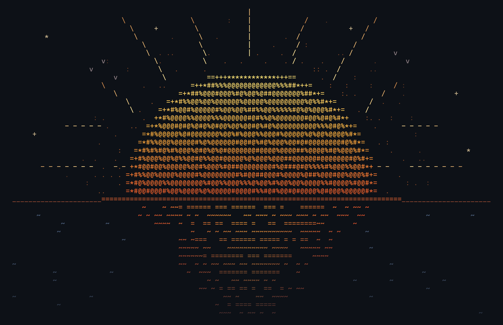
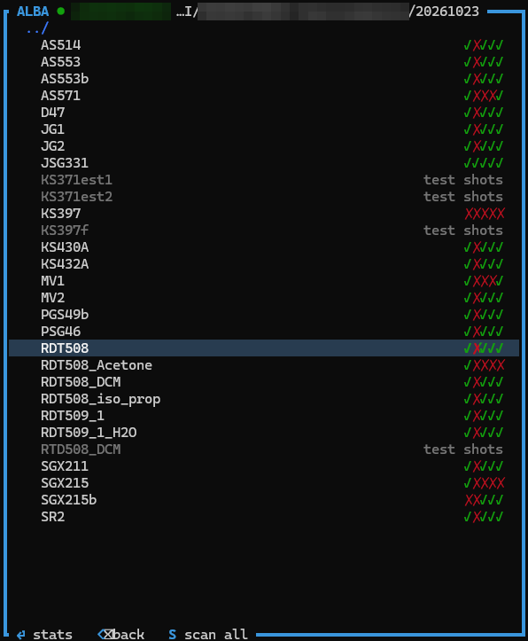
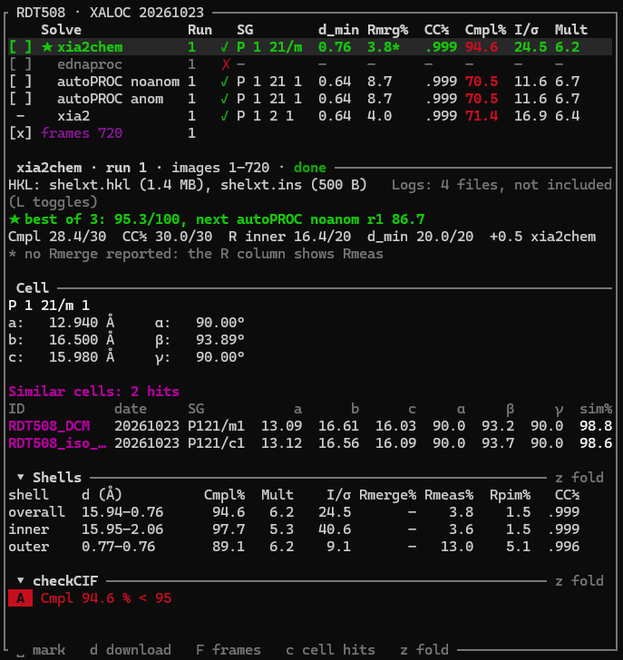

<p align="center"></p>

# Amanece

Terminal UI SFTP client to connect to the ALBA BL13-XALOC/BL6-XAIRA servers: browse your beamtime results,
compare the statistics of every solve (xia2chem, ednaproc, autoPROC, xia2), search for similar unit cells, download the HKL
files you pick into the local folder, and run any commands (PLATON, SHELXT, XPREP,...) on them.

Read-only, gentle and safe by design: one SFTP connection channel, rate-limited requests, and nothing about
your login is stored unless you tick a box: "Remember username" saves the username, "Remember
password" puts the password in the system's credential store (never in a file). 
See [DESIGN.md](DESIGN.md).

## Installation

### Prebuilt binaries

Every tagged version is published under [Releases](https://github.com/Yluro/amanece/releases)
with one archive per platform:

| Platform | Archive |
|---|---|
| Windows 10 / 11 (x64) | `amanece-<version>-x86_64-pc-windows-msvc.zip` |
| macOS, Intel | `amanece-<version>-x86_64-apple-darwin.tar.gz` |
| macOS, Apple silicon | `amanece-<version>-aarch64-apple-darwin.tar.gz` |
| Linux (x64, glibc) | `amanece-<version>-x86_64-unknown-linux-gnu.tar.gz` |

Unpack it and put `amanece` (`amanece.exe`) somewhere on your `PATH`. Each archive has a
`.sha256` file next to it.

### Updating

The version is shown at the right end of the status bar. Amanece routinely asks GitHub
whether there is a newer release. When there is, the version box turns into a green `↑ v0.4.0`: press `U` 
(or click it) and say `y`, and amanece downloads this platform's
archive, checks it against its `.sha256`, makes sure the new binary starts, 
Restart amanece again to use the new version. `o` in that dialog opens the release notes.
`check_updates = false` in `config.toml` stops the automatic check; `U` still checks when you ask.

**Requisites:**

- **Windows**: Windows 10 version 1809 or newer (the console panel needs ConPTY). 
- **macOS**: Binaries downloaded with a browser carry a quarantine flag; clear it once with
  `xattr -d com.apple.quarantine amanece`.
- **Linux**: glibc 2.35 or newer (Ubuntu 22.04 / Debian 12 or newer; the binaries are built on Ubuntu 22.04).
  The C and C++ runtimes (`libc`, `libgcc_s`) are on every normal install; `xdg-open` is used to open files.
  "Remember password" needs a Secret Service keyring (GNOME Keyring or KWallet, normal on a desktop);
  without one the password just isn't saved.

### Build from source

You need [Rust](https://rustup.rs) (stable, 1.88 or newer) and a C/C++
toolchain, because some dependencies (`ring`) compile C code:

- **Windows**: *Visual Studio Build Tools* (or Visual Studio) with the **Desktop development with C++**
  workload: the MSVC compiler and linker plus a Windows 10/11 SDK. This is the same toolchain
  that rustup's `x86_64-pc-windows-msvc` target asks for. The repo's `.cargo/config.toml` makes the
  build use the static CRT, so the result runs without the redistributable.
  `winget install Microsoft.VisualStudio.2022.BuildTools` gets the installer.
- **macOS**: Xcode Command Line Tools, `xcode-select --install`.
- **Linux**: a C compiler and linker, e.g. `sudo apt install build-essential` (Debian / Ubuntu)
  or `sudo dnf groupinstall "Development Tools"` (Fedora).

To build amanece from source, clone the repository and install it using cargo:

```bash
git clone https://github.com/Yluro/amanece        # clone the amanece repository code
cd amanece                                        # move to the amanece folder
git checkout "$(git describe --tags --abbrev=0)"  # (optional) checkout to the lastest stable release
cargo install --path .                            # install amanece into your user path
```


## Running amanece

You can simply run amanece by calling the executable from any terminal:

```bash
amanece
```
The TUI is fully mouse and keyboard compatible.

Tick **Remember username** in the login dialogue (`Tab` to it, `Space`, or click) to have the username
prefilled next time. Up to 10 usernames are remembered: the last one used is prefilled and `←`/`→` in
the username field picks another. Only usernames are saved, in `login.toml`. To forget one, pick it
and press `Del` (or log in with the box unticked).

**Remember password** (off by default) also keeps that account's password in your system's credential 
manager under the name `amanece`; next time it is filled in and `Enter` connects. It is saved only after 
the server accepted it. If the server ever rejects a saved password (someone changed it), 
amanece deletes it and asks you to type the new one, so it never retries a wrong password on its own.

## Key shortcuts

`?` lists all key shorcuts and symbols. Each panel shows its key hints on its bottom border.

### Global keys

| Key | Action |
|---|---|
| `Tab` | cycle panels |
| `p` | cycle polling: manual → 10 min → 2 min → 30 s → 5 s (the fast rates only re-list the open beamtime; sample rescans stay at most once a minute) |
| `n` | toggle the new-sample sound |
| `E` | open the Local folder in the file explorer |
| `O` | open amanece's folder (config, cache, log) |
| `U` | update amanece (see [Updating](#updating)) |
| `q` | quit (asks first) |

### Local panel (left)

Browse folders; `N` makes a new folder, `Supr` moves the selected file or folder to the Recycle Bin
(asks first). Downloads land in `<sample>/<program>/` inside the folder open here.
### ALBA panel



Beamtimes appear like folders, from XALOC (BL13) and XAIRA (BL06) together, newest first. `Enter`
opens one (the others are hidden), `Backspace` goes back.

- A green ◆ next to a sample: it's already downloaded (from this beamtime) into the Local folder.
- A yellow ◆: only a local folder with the same name exists.

### Stats panel



Every solve with its statistics, ★ on the best one. Under the table, the highlighted solve's details
come in sections:

- **Solve**: HKL and log files, and the ★ ranking.
- **Cell**: space group, a b c and α β γ, and the similar cells.
- **Shells**: overall, inner, outer.
- **checkCIF**: alerts.

`z` folds Shells and checkCIF to their title lines (a folded checkCIF title still shows the alert
levels) and `z` again unfolds them; clicking either title does the same.

**Keys:** `Space` marks, `d` downloads, `F` downloads raw frames (asks first), `c` toggles all similar
cells, `z` folds.

#### Ranking

The ranking shows how the ★ was chosen: each solve's points for completeness (30), CC½ (30),
inner-shell R (20) and d_min (20), its place in the ranking, and for the others how far behind ★
they are and which criterion cost them most (or why a solve isn't ranked at all: failed, running,
no HKL file).

#### checkCIF alerts

Values that would draw a checkCIF alert are coloured, yellow for C, orange for B and red for A:

| Value | checkCIF test | C / B / A |
|---|---|---|
| d_min | THETM01 | sin θ/λ < 0.590 / 0.575 / 0.550 |
| Completeness | PLAT029 | < 99 / 97 / 95 % |
| Rmerge (stand-in for Rint) | RINTA01 | > 10 / 15 / 20 % |

The checkCIF section spells each alert out. These come from the pipeline's overall shell, so they
are a warning at the beamline, not checkCIF itself: the completeness runs to the pipeline's d_min
(checkCIF tests θ_full, usually higher), and checkCIF doesn't publish the PLAT029 limits (these are
read off real reports). Change the limits in the `[checkcif]` section of
[`config.toml`](#checkcif-alert-limits).

#### Similar cells

In the Cell section, **Similar cells** lists the samples whose cell matches, from the unit-cell
database (see `cells.toml` below), closest first: code, beamtime date, space group, their own
a b c α β γ and `sim%`. `sim%` is 100 minus the largest difference in % of the edge (an angle off by
`cell_match_deg` counts like an edge off by `cell_match_pct`): 100 for the same cell, 98.5 at the
default match limit.

Long sample names are cut (…) so each sample stays on one row. It lists the closest 5, then
`+N more`; `c` (or a click on `+N more`) lists them all, `c` again only the closest 5. When the
panel is too short for the whole list, it says so; `z` makes room.

#### Downloads

- Frames download a few files at a time (`parallel_downloads` in the config, default 3) with a
  progress bar above the status bar; more frame datasets wait their turn.
- HKL/log downloads (`d`) jump the queue and start right away, even while frames are downloading.
- If the connection drops, it reconnects and continues where each file stopped.
- Every frame is checked against the MD5 checksum stored in its own CBF header, both after it
  arrives and when one already in the folder is skipped; a frame that fails is downloaded again.

### Console panel

A terminal (Windows ConPTY); `:` to type. Commands run in the Local folder and a bare program name
gets the selected file: with `XDS_ASCII.HKL` selected, `xprep` runs `xprep XDS_ASCII.HKL`.
Interactive console programs work: while SADABS (or any program) runs, what you type plus Enter is
its answer; Ctrl-C interrupts, twice kills. XPREP and other Windows GUI programs open in their own
window.

### Mouse

Click a panel or row, double-click to open, click a Stats checkbox to mark, wheel to scroll, click
the status badges (poll / sound / logs) to toggle. Shift+drag still selects text in Windows Terminal.

## config.toml

Amanece's settings can be configured by editting: `config.toml`, in amanece's own folder (`O` in the app opens it; see
[Files it writes locally](#files-it-writes-locally) for the path). It is written once, with comments,
on the first run and never rewritten afterwards, so edit it freely; changes take effect the next time
amanece starts. Any key that is missing uses its default, so a `config.toml` from an older version
keeps working and you only need the lines you want to change. It never holds credentials.

### Connection and polling

| Key | Default | Meaning |
|---|---|---|
| `host` | `"userdata.cells.es"` | SFTP server |
| `port` | `443` | SFTP port |
| `poll_mode` | `"manual"` | polling at startup: `"manual"`, `"slow"`, `"fast"`, `"30s"` or `"5s"` (`p` cycles them in the app) |
| `slow_poll_minutes` | `10.0` | interval of the `slow` mode |
| `fast_poll_minutes` | `2.0` | interval of the `fast` mode |
| `max_requests_per_second` | `3.0` | sustained SFTP request rate (capped at 5) |
| `burst` | `6` | requests allowed in a burst above that rate |
| `parallel_downloads` | `3` | frames downloaded at a time (1–4); HKL/log downloads always get an extra slot |
| `check_updates` | `true` | ask GitHub for a newer release at startup and once a day (`U` still works when off) |

Polls never run more often than every 5 s, and at `30s` / `5s` only the open beamtime is re-listed;
the beamtime list and sample rescans happen at most once a minute.

### Where the data is

| Key | Default | Meaning |
|---|---|---|
| `beamlines` | `["bl13", "bl06"]` | beamline folders searched for your proposal (bl13 = XALOC, bl06 = XAIRA) |
| `remote_root` | unset | proposal folder on the server, e.g. `"/bl13/projects/cycle2026-I/<account digits>-<pi>"`; only needed when it isn't found automatically |
| `default_folder` | unset | Local folder amanece always opens in, e.g. `"C:/Users/you/Documents/alba"`. Unset, it opens where it was when last closed (the launch folder the first time) |

### Behaviour

| Key | Default | Meaning |
|---|---|---|
| `sound` | `true` | beep when a new named sample gets processing results (`n` toggles it) |
| `include_logs` | `false` | also download logs (summary.html, xia2.txt, CORRECT.LP, …) with the HKL files |
| `show_test` | `false` | show samples named `test…` and characterisation-only samples |
| `external_window` | `["xprep"]` | programs always started in their own window instead of the Console panel (Windows GUI programs are detected automatically) |

### Similar cells

| Key | Default | Meaning |
|---|---|---|
| `cell_match_pct` | `1.5` | two reduced cells match within this many % on each edge… |
| `cell_match_deg` | `2.0` | …and this many degrees on each angle |

### `[checkcif]` alert limits

Each list gives the limits for alert levels C, B and A (see [checkCIF alerts](#checkcif-alerts)).
This section has to come after all the keys above, since everything below a `[section]` line belongs
to it.

```toml
[checkcif]
sin_theta_lambda = [0.590, 0.575, 0.550]   # THETM01: 1/Å, alert below (d_min 0.85 / 0.87 / 0.91 Å)
completeness = [99.0, 97.0, 95.0]          # PLAT029: %, alert below
rint = [10.0, 15.0, 20.0]                  # RINTA01: %, alert above (compared with Rmerge, or Rmeas if no Rmerge)
```

## Files
Amanece writes several files for logging/database creation/

- `.alba_source.json` in each download folder – which server file each download came from

Everything else goes in one folder, `%APPDATA%\amanece\config\` on Windows (`~/.config/amanece/`
on Linux, `~/Library/Application Support/amanece/` on macOS). Press `O` in the app to open it.

- `config.toml` – settings, see [config.toml](#configtoml)
- `known_hosts` – the server's pinned host key
- `cache-<id>.json` – listings and stats already fetched, one file per account (`<id>` is a hash,
  not the username)****
- `amanece.log` – console log (useful for bug reports)
- `login.toml` – the usernames that have "Remember username" ticked
- `cells.toml` – the unit-cell database: one entry per scanned sample (code, beamtime date, space
  group and cell of its ★ solve), from every account's cache. Add your own cells (starting materials,
  ligands, salts) as `[[cell]]` entries with a `code`, an `sg` and a `cell = [a, b, c, α, β, γ]`;
  amanece only updates the entries that have a `from` line. Cells are compared as Niggli-reduced
  primitive lattices, so other settings (P2₁/c vs P2₁/n, C2/c vs P-1, swapped axes) still match.
  The tolerances are `cell_match_pct` (edges, default 1.5 %) and `cell_match_deg` (angles, 2°) in
  [`config.toml`](#similar-cells-1).

Saved passwords are not in this folder: they are in the system's credential store (see above).

Older versions kept the cache and log in `.amanece/` inside the launch folder. amanece still reads
an old cache from there (so nothing is fetched again) but never writes there. Once you have logged
in with this version, you can delete those folders.

## Tests

```bash
cargo test
# live checks against the real server (a few dozen read-only requests):
ALBA_USER=… ALBA_PASS=… cargo test live_ -- --ignored --nocapture
# downloads under forced session drops (resume); ALBA_KEEP=1 keeps the files to compare
ALBA_USER=… ALBA_PASS=… ALBA_DATE=… ALBA_SAMPLE=… ALBA_FRAMES_N=9 ALBA_DOWNLOAD=1 AMANECE_REKEY_MB=16 \
  cargo test --release live_app_flow -- --ignored --nocapture
```
